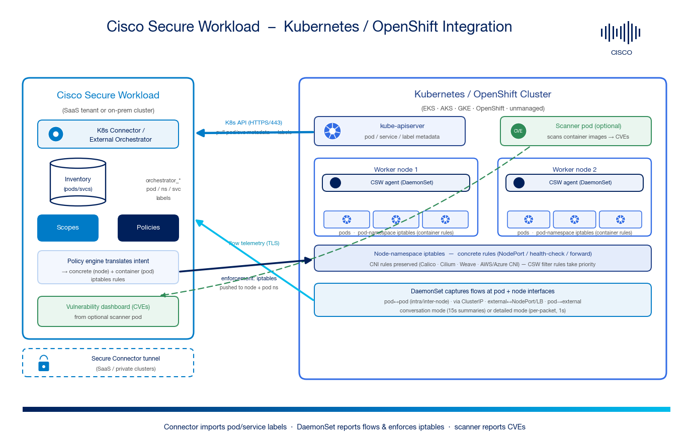

# Cisco Secure Workload → Kubernetes / OpenShift Integration Guide


A step-by-step, **beginner-friendly** guide to integrating a **Kubernetes or OpenShift cluster** with **Cisco Secure Workload (CSW)** — covering the **Kubernetes connector / external orchestrator**, the **node-agent DaemonSet**, **flow visibility**, **iptables-based micro-segmentation** for pods & services, and optional **container image vulnerability scanning**.

Unlike a label-only orchestrator, the Kubernetes integration is a **two-way** path:

1. The **connector** pulls **pod / service / namespace metadata** from the Kubernetes API into CSW as **labels** (`orchestrator_*`).
2. The **DaemonSet node agent** reports **network flows** to CSW **and** enforces policy by programming **iptables** rules in the **node** and **pod** namespaces.
3. An optional **scanner pod** reports **container image CVEs** back to CSW.

> **⚠ Disclaimer:** This is a **community reference guide** prepared by Cisco Solutions Engineering — not an official Cisco product document. Always refer to the [official Cisco Secure Workload documentation](https://www.cisco.com/c/en/us/support/security/tetration/series.html), the [Secure Workload and Kubernetes deep-dive](https://secure.cisco.com/secure-workload/docs/secure-workload-and-k8s), and the [Compatibility / Integration Requirements Matrix](https://www.cisco.com/c/m/en_us/products/security/secure-workload-compatibility-matrix.html) for authoritative, up-to-date guidance.

---

## 0. New to CSW or Kubernetes segmentation? Read this first (2 minutes)

- **Cisco Secure Workload (CSW)** discovers how applications talk and builds **least-privilege micro-segmentation** using **labels → scopes → policies**. It enforces at the host/OS layer (Linux iptables, Windows Filtering Platform) rather than relying on the network path.
- **Kubernetes / OpenShift** run your applications as **pods** grouped into **services** and **namespaces** across a set of **worker nodes**. Pod IPs are ephemeral and churn constantly — which is exactly why **IP-based** firewalling breaks down and **label-based** policy wins.

**Why integrate them?**

| Problem without the integration | What the integration gives you |
|---|---|
| Pod IPs change constantly — static firewall rules are stale in minutes | The **connector** imports live pod/service metadata; policy is written against **labels** (namespace, service, app) and **follows the workload** |
| No east-west visibility inside the cluster | The **DaemonSet** captures **every pod↔pod, pod↔service, and external flow** at both pod and node interfaces |
| CNI network policy is allow/deny by label but has no central intent, analysis, or audit trail | CSW gives you **policy discovery, real-time analysis, versioning, and compliance monitoring** across clusters *and* the rest of your estate (VMs, cloud, bare metal) |
| Unknown CVE exposure in running images | The optional **scanner pod** enumerates images and reports **CVEs**, which become policy attributes |

> **Key idea:** CSW does **not** replace your CNI. Existing CNI iptables rules are **preserved**; CSW inserts its **filter rules with priority** on top (the *Preserve rules* agent option must be enabled for Kubernetes/OpenShift — see [§7.5](#75-preserve-rules-mandatory-for-kubernetes)).

---

## 1. Architecture



*The connector pulls pod/service metadata over the Kubernetes API into CSW inventory as labels. The DaemonSet node agents report flow telemetry to CSW and enforce policy by programming node- and pod-namespace iptables. An optional scanner pod reports container CVEs. For SaaS or private clusters the paths ride a Secure Connector tunnel.*

There are **four major components**:

| # | Component | Where it runs | Role |
|---|---|---|---|
| 1 | **Control / management plane** | CSW SaaS tenant or on-prem cluster | Processes telemetry; where labels, scopes, policies are defined, analyzed, versioned, and monitored |
| 2 | **Kubernetes connector / external orchestrator** | Created on the CSW management plane | Talks to the **Kubernetes API** (EKS / AKS / GKE / OpenShift / unmanaged) to import **pod & service metadata** — IDs, annotations, labels → CSW **tags/labels** |
| 3 | **DaemonSet node agent** | One agent pod **per node** | **Flow visibility** (conversation or detailed mode) **+ policy enforcement** (programs iptables on each node) |
| 4 | **Vulnerability scanner** *(optional)* | One scanner pod on the cluster | Scans every Linux container image → reports **CVEs** to the management plane |

| Path | Direction | Transport | Purpose |
|---|---|---|---|
| **Connector → K8s API** | CSW → cluster | HTTPS (TCP/443, K8s API) | Import pod/service/namespace metadata → `orchestrator_*` labels |
| **DaemonSet telemetry** | node agent → CSW | TLS | Report captured network flows |
| **Policy enforcement** | CSW → node agent | TLS (agent control channel) | Push intent → agent programs **node + pod iptables** |
| **Scanner** | scanner pod → CSW | TLS | Report container image CVEs |

---

## 2. What you get

**Inventory & labels** — every pod and service becomes CSW inventory, continuously updated in near real-time. When a pod is added, or a label/annotation changes, CSW reflects it automatically. Kubernetes metadata surfaces as `orchestrator_*` labels you can search, scope, and enforce on:

| Key (examples) | Value |
|---|---|
| `orchestrator_system/orch_type` | `kubernetes` |
| `orchestrator_system/cluster_name` | *(the connector/cluster name you configured)* |
| `orchestrator_system/namespace` | e.g. `sock-shop` |
| `orchestrator_system/service_name` | e.g. `carts` |
| `orchestrator_<pod-label-key>` | *(any pod label/annotation, e.g. `orchestrator_app=payment`)* |

**Flow visibility** — granular flows (down to TCP/UDP flags, byte/packet counts) enriched with the labels above, for:
- **Pod ↔ pod** (intra-node and inter-node; direct or via ClusterIP service)
- **External ↔ pod** (via NodePort or LoadBalancer service)
- **Pod → external**

**Micro-segmentation** — write policy in label terms; CSW's policy engine translates intent into **concrete (node)** and **container (pod)** iptables rules and programs them via the DaemonSet.

**Vulnerability scanning** *(optional)* — CVE inventory per image; CVE severity becomes a policy attribute for **risk-based segmentation**.

---

## 3. Prerequisites

### Kubernetes / OpenShift side
- A supported cluster: **EKS, AKS, GKE, OpenShift, or unmanaged/self-managed Kubernetes**. (OpenShift **SDN** is supported; **OVN is not supported yet** — see [FAQ](#12-faqs).)
- **Node OS:** Linux and Windows nodes are both supported — see the [Compatibility Matrix](https://www.cisco.com/c/m/en_us/products/security/secure-workload-compatibility-matrix.html) for the exact list.
- **Container runtime:** containerd, Docker, or CRI-O (all leading runtimes supported).
- **CNI:** any popular CNI — Calico, Cilium, Weave, Azure CNI, AWS VPC CNI, etc. CSW is **not** dependent on specific CNI functions.
- **Cluster admin** access to install the DaemonSet (RBAC objects, a namespace, and a privileged/host-network DaemonSet).
- A **kubeconfig** or **service-account token** for the connector to reach the Kubernetes API (read access to pods, services, namespaces, nodes, endpoints).

### Cisco Secure Workload side
- CSW **4.x** (on-prem or SaaS). Connectors live under **Manage → Connectors**; external orchestrators under **Manage → Workloads → External Orchestrators**.
- A user with **Site Admin / Root Scope Owner** rights (or an API key with the `external_integration` capability for the API path in [§10](#10-alternative-automate-via-openapi--iac)).
- For **SaaS** or clusters with no direct route to CSW: a healthy **Secure Connector** tunnel.

### Network / firewall
- **HTTPS (TCP/443)** from the CSW source (cluster egress / SaaS egress / Secure Connector VM) **→ the Kubernetes API server**.
- **Agent control + telemetry** from each **node → CSW** (TLS). Confirm the exact ports/FQDNs for your tenant in the CSW *Agent Config* / connector download page.

### 3.1 Create a least-privilege connector service account (recommended)

Give the connector a **read-only** ServiceAccount rather than a cluster-admin kubeconfig:

```yaml
# examples/connector-rbac.yaml  (read-only access for the CSW connector)
apiVersion: v1
kind: ServiceAccount
metadata:
  name: csw-connector
  namespace: tetration
---
apiVersion: rbac.authorization.k8s.io/v1
kind: ClusterRole
metadata:
  name: csw-connector-readonly
rules:
  - apiGroups: [""]
    resources: ["pods", "services", "endpoints", "namespaces", "nodes"]
    verbs: ["get", "list", "watch"]
---
apiVersion: rbac.authorization.k8s.io/v1
kind: ClusterRoleBinding
metadata:
  name: csw-connector-readonly
subjects:
  - kind: ServiceAccount
    name: csw-connector
    namespace: tetration
roleRef:
  kind: ClusterRole
  name: csw-connector-readonly
  apiGroup: rbac.authorization.k8s.io
```

> **Security:** Store the resulting kubeconfig/token in your secrets manager. Never commit it to source control. The connector only needs **read** access to discover inventory — the **DaemonSet** (installed separately) is what performs enforcement.

---

## 4. Choose your rollout order

A safe, staged rollout:

1. **Connector first** ([§5](#5-configure-the-kubernetes-connector--external-orchestrator)) → get pod/service **labels** into CSW with zero risk.
2. **DaemonSet in visibility mode** ([§6](#6-deploy-the-daemonset-node-agent)) → collect **flows**; no enforcement yet.
3. **Policy discovery + analysis** ([§8](#8-zero-trust-micro-segmentation-for-kubernetes)) → build and validate policy against live traffic **without enforcing**.
4. **Enforcement** ([§8 Step 4](#step-4--enforce-policies-iptables-translation)) → flip the workspace to enforced; CSW programs iptables. Roll out namespace-by-namespace.
5. **Vulnerability scanning** ([§9](#9-vulnerability-scanning-optional)) → optional CVE visibility.

---

## 5. Configure the Kubernetes connector / external orchestrator

**Path (connector):** `Manage → Connectors → Kubernetes` → **Enable / Create**
**Path (orchestrator):** `Manage → Workloads → External Orchestrators → Create New Configuration → Type = Kubernetes / OpenShift`

### Step 1 — Basic details

| Field | Required | Value / guidance |
|---|---|---|
| **Name** | ✅ | Unique per tenant, e.g. `eks-prod-us-east-1` |
| **Type** | ✅ | `Kubernetes` (or `OpenShift`) |
| **Description** | ❌ | e.g. "Prod EKS cluster — inventory + flows + enforcement" |
| **Auth** | ✅ | Upload the **kubeconfig** or paste the **CA cert + service-account token** for the read-only account ([§3.1](#31-create-a-least-privilege-connector-service-account-recommended)) |
| **Delta / Full snapshot interval** | ❌ | How often to re-poll inventory; defaults are fine for most clusters |
| **Secure Connector Tunnel** | ❌ | Check for **SaaS / private** clusters that CSW can't reach directly |

### Step 2 — Hosts List / API endpoint

- Enter the **Kubernetes API server** FQDN/IP and port (usually `443`).
- Point at the **API server**, not individual nodes.
- One connector = **one cluster**. A second cluster needs a **second** connector.

### Step 3 — Create & verify connection

Click **Create**. Within ~1 minute the **Connection Status** should reach **Success** and the first inventory snapshot begins asynchronously (large clusters take longer).

### 5.1 (SaaS / private clusters) Secure Connector tunnel

Skip if CSW is **on-prem** and can reach the API server directly. For **SaaS** or a non-routable API server:

1. In CSW: **Manage → Workloads → Secure Connector** → register the client on a Linux VM that **can** reach the cluster API.
2. Size per the [Compatibility Matrix](https://www.cisco.com/c/m/en_us/products/security/secure-workload-compatibility-matrix.html).
3. Confirm the Secure Connector is **Active/Connected**, then check **Secure Connector Tunnel** on the connector.

---

## 6. Deploy the DaemonSet node agent

The connector gives you **inventory**. To get **flow visibility and enforcement**, deploy the CSW **agent as a DaemonSet** so exactly one agent runs on **every node** (including new nodes as they scale).

### 6.1 Recommended: install with the CSW-generated installer

1. In CSW: **Manage → Agents → Installer** (or the **Kubernetes** tab of the connector) → choose **Kubernetes / OpenShift**.
2. Download the generated **installer script / manifest bundle** — it is pre-populated with your tenant's **activation key, cluster CA, and control-plane FQDNs**, and includes the namespace, RBAC, and DaemonSet.
3. Apply it against the cluster:

```bash
# The installer is generated per-tenant by CSW and already contains your
# activation key + cluster endpoints. Do NOT hardcode secrets in your own copy.
kubectl apply -f cisco-tetration-<cluster>.yaml
# or, if the bundle ships a script:
./install_k8s_agent.sh -k /path/to/kubeconfig
```

4. Confirm one agent pod per node:

```bash
kubectl -n tetration get daemonset
kubectl -n tetration get pods -o wide        # one CSW pod per node, STATUS=Running
```

> A **representative** DaemonSet manifest and RBAC are included in [`examples/csw-agent-daemonset.yaml`](examples/csw-agent-daemonset.yaml) **for understanding only** — always deploy the **CSW-generated** bundle for your tenant so activation keys and endpoints are correct.

### 6.2 What the DaemonSet needs (and why)

| Requirement | Why |
|---|---|
| `hostNetwork: true` | Capture flows on node interfaces and program **node-namespace** iptables |
| Privileged / `NET_ADMIN`, `NET_RAW`, `SYS_ADMIN` capabilities | Read/write iptables in **node and pod** network namespaces |
| Host mounts (e.g. `/proc`, `/var/run`, container runtime socket) | Discover pods/containers and their namespaces |
| Tolerations for control-plane/taints | So the agent also runs on tainted/master nodes if required |

### 6.3 Flow capture modes

The agent captures flows at **both** the pod and node network interfaces:

| Mode | Behavior | When to use |
|---|---|---|
| **Conversation mode** | Summarizes flow observations every **15s**, reports every **15s** | Default; lower overhead, large clusters |
| **Detailed mode** | Captures **every packet** (node + pod namespace), reports every **~1s** | Deep troubleshooting / high-fidelity discovery |

---

## 7. Understand how flows are captured (so policy makes sense)

CSW reports different flow records depending on the communication type. Knowing this makes the enforcement rules in [§8](#8-zero-trust-micro-segmentation-for-kubernetes) intuitive.

### 7.1 Direct pod ↔ pod
- **Intra-node** (same node): a single deduped flow `pod1 IP → pod2 IP` (captured at both interfaces, deduped to one).
- **Inter-node** (different nodes): a flow `pod1 IP → pod2 IP` at the source; depending on CNI mode a second record may appear:
  - **Direct routing** (routable pod CIDR): no extra flow — same flow deduped.
  - **Overlay VXLAN/Geneve:** an extra **UDP** tunneled flow `node1 IP → node2 IP` encapsulating the packet.
  - **IPIP:** an extra **TCP** flow `node1 IP → node2 IP`.

### 7.2 Pod ↔ pod via ClusterIP service
- **Intra-node:** flow 1 `pod1 → ClusterIP` (source pod iface); after **DNAT** in the node namespace, flow 2 `pod1 → pod2 IP` (dest pod iface). The two show as **Related** flows.
- **Inter-node:** flow 1 `pod1 → ClusterIP`; after DNAT, flow 2 `pod1 → pod2 IP` at node1; plus a possible third flow per CNI mode (as in §7.1).

### 7.3 External ↔ pod (NodePort / LoadBalancer)
1. `External IP → Node IP:NodePort` (node interface).
2. Traffic undergoes **SNAT + DNAT** → source becomes node IP; dest becomes `pod IP:pod port`.
3. `Node IP → pod IP:pod port` (pod interface).
4. A third flow may appear if the pod isn't on the landing node (per CNI mode).

> NodePort and LoadBalancer are essentially the same on-cluster; LoadBalancer just adds a cloud external LB that fronts the nodes.

### 7.4 Pod → external
1. `pod IP → external IP` (source pod interface).
2. After **SNAT** in the node namespace: `node IP → external IP` (node interface).

### 7.5 "Preserve rules" — mandatory for Kubernetes
CSW filter rules take **priority**, and iptables rules created by the **CNI are preserved**. The agent's **Preserve rules** option **must be enabled** for Kubernetes and OpenShift deployments so CSW coexists with the CNI instead of flushing its chains. Set this in the **Agent Config Profile** applied to the cluster scope.

---

## 8. Zero-trust micro-segmentation for Kubernetes

The journey: **scope design → policy discovery → analysis → enforcement → compliance monitoring.**

### Step 1 — Scope design

| Approach | When | How |
|---|---|---|
| **Single scope** | Manage a whole cluster (or a group of similar clusters) as one unit | Map one/more clusters to a single scope |
| **Split scope** | Multiple apps on one cluster, managed independently | Cluster → **parent** scope; each app (often per **namespace**) → **child** scope |

> **Tip:** if each app lives in its own Kubernetes **namespace**, create child scopes on `orchestrator_system/namespace = <ns>`.

### Step 2 — Policy discovery

- **Manual:** via GUI, OpenAPI, or IaC (Terraform / Ansible).
- **Automated:** CSW's **policy discovery** engine mines the inventory + flows from [§6](#6-deploy-the-daemonset-node-agent) to auto-generate candidate policies.

### Step 3 — Analyze & validate (no enforcement)

Use **live policy analysis** to run a policy **version** against real cluster traffic and spot unexpected allows/denies **before** you enforce. This requires **no** rules on the cluster.

### Step 4 — Enforce policies (iptables translation)

When you enforce, CSW's policy engine translates intent into:
- **Concrete (node) rules** → programmed in the **node-namespace** iptables.
- **Container (pod) rules** → programmed in the **pod-namespace** iptables.

Below are the canonical patterns and exactly what the engine programs. (Pod identity is matched by **Pod ID**, so a source/destination of "Any" means "any interface belonging to that pod.")

#### Pattern A — Direct pod → pod (no service)
*Intent: Allow `payment` pod → `user-db` pod on **TCP/27017**.*

| Where | Rule |
|---|---|
| **payment pod** (pod ns) | `EGRESS` allow → user-db pod on TCP/27017 |
| **user-db pod** (pod ns) | `INGRESS` allow ← payment pod on TCP/27017 |
| **Node** (node ns) | *none* — CNI `forward` chain (allow-all) handles inter-node routing |

#### Pattern B — Pod → pod via ClusterIP service
*Intent: Allow `frontend` pod → `carts` **service** on **TCP/80** (service IP `10.100.135.136`, carts pod also on 80).*

| Where | Rule |
|---|---|
| **frontend pod** (pod ns) | `EGRESS` allow → carts **ClusterIP** on TCP/80 |
| **carts pod** (pod ns) | `INGRESS` allow ← frontend pod on TCP/80 *(dest DNAT'd to carts pod IP in node ns; the engine auto-generates the pod-IP allow even though only the service was named in the intent)* |
| **Node** (node ns) | *none* — CNI handles forward |

#### Pattern C — Node → pod health-check / readiness probe
*Intent: Allow Kubernetes health/readiness probes → `frontend` pod on **TCP/80**.*

| Where | Rule |
|---|---|
| **Node** (node ns) | `EGRESS` allow node IP → pods on TCP/80 |
| **frontend pod** (pod ns) | `INGRESS` allow node IPs → any (pod) on TCP/80 |

#### Pattern D — External → pod via NodePort / LoadBalancer
*Intent: Allow **any** internet client → `frontend` NodePort service (pod listens 8079, NodePort 31095).*

| Where | Rule |
|---|---|
| **Node** (node ns) | `INGRESS`/PREROUTING allow any → node pool IPs on **NodePort TCP/31095** *(auto-generated pre-routing allow)* |
| **frontend pod** (pod ns) | `INGRESS` allow any → frontend pod IP on **TCP/8079** *(auto-generated pod-port allow)* |

> **Split-scope gotcha:** if **nodes** and **app pods/services** are in **different** parent/child scopes, add the allow rule to **both** scopes.

#### Pattern E — Pod → external IP
*Intent: Allow `frontend` pod IPs → an external IP on **TCP/666**.*

| Where | Rule |
|---|---|
| **frontend pod** (pod ns) | `EGRESS` allow → external IP on TCP/666 |
| **Node** (node ns) | *none* — traffic is SNAT'd to node IP and allowed by default `forward` (allow-all) |

### Step 5 — Monitor compliance
Keep **live policy analysis** running post-enforcement to catch drift or unexpected allow/deny outcomes as the app changes.

### 8.1 Inspect the programmed rules on a node (verification)

```bash
# Exec into the CSW agent pod on a node, or run on the node host:
sudo iptables -S | grep -i ta_          # CSW/Tetration filter chains
sudo iptables -t nat -S | grep -i ta_   # NAT / pre-routing (NodePort) rules
# Confirm CNI chains (e.g. cali-*, KUBE-*) are still present = Preserve rules working
sudo iptables -S | grep -Ei 'cali-|KUBE-'
```

---

## 9. Vulnerability scanning (optional)

1. For any onboarded cluster, **enable vulnerability scanning** on the connector — a **scanner pod** spins up on the cluster.
2. The scanner enumerates running **Linux** container images and auto-populates the **registries** in the CSW console.
3. If a registry needs credentials, CSW prompts you to add them (stored encrypted).
4. The scanner pulls images and reports **CVEs**; results appear on the **Vulnerability dashboard**.
5. **CVE attributes become policy objects** — build **CVE-risk-based** segmentation (e.g. quarantine pods with critical CVEs).

> **Requires** the DaemonSet/agent from [§6](#6-deploy-the-daemonset-node-agent). Only **Linux** container CVE scanning is supported at the time of writing.

---

## 10. (Alternative) Automate via OpenAPI / IaC

You can create the connector and manage policy from code. The API key needs the `external_integration` capability.

```python
import os, json

# Create a Kubernetes external orchestrator
req_payload = {
    "name": "eks-prod-us-east-1",
    "type": "kubernetes",
    "description": "Prod EKS - inventory + flows + enforcement",
    "hosts_list": [
        {"host_name": "K8S_API_FQDN", "port_number": 443}
    ],
    # Pull secrets from env / a secrets manager - never hardcode credentials
    "auth_token": os.environ["CSW_K8S_SA_TOKEN"],
    "ca_certificate": os.environ["CSW_K8S_CA_CERT"],
    "use_secureconnector_tunnel": True    # SaaS / private clusters
}

resp = restclient.post("/orchestrator/Default", json_body=json.dumps(req_payload))
print(resp.status_code, resp.text)
```

> **Security note (per repo policy):** the sample reads the token/CA from environment variables rather than embedding them. Never commit credentials, tokens, or kubeconfigs; store them in a secrets manager and inject at runtime (see [`.gitignore`](.gitignore)).

- **Policy as code:** CSW ships **Terraform** and **Ansible** providers — write policy playbooks and push updates from your **CI/CD pipeline**.

---

## 11. Caveats & troubleshooting

| Symptom / topic | Guidance |
|---|---|
| **Connector status not "Success"** | Verify HTTPS reachability to the **K8s API server**, the SA token/CA are valid, and (SaaS) the Secure Connector is Active. |
| **No pods/services in inventory** | Check the connector RBAC allows `get/list/watch` on pods, services, namespaces, nodes, endpoints. |
| **Agent pod not on every node** | It's a **DaemonSet** — check tolerations for tainted/control-plane nodes; `kubectl -n tetration describe ds`. |
| **CNI stopped working after enforcement** | **Preserve rules** must be enabled ([§7.5](#75-preserve-rules-mandatory-for-kubernetes)) — CSW must coexist with, not flush, CNI chains. |
| **Enforced policy not taking effect on a pod** | Confirm the pod is in the enforced scope, the workspace is **enforced**, and inspect node iptables ([§8.1](#81-inspect-the-programmed-rules-on-a-node-verification)). |
| **NodePort/LB traffic blocked** | Add the NodePort allow on the **node** scope *and* the pod-port allow on the **pod** scope — both (see Pattern D + split-scope note). |
| **Inter-node pod traffic looks like node↔node UDP/TCP** | Expected with **overlay** CNIs (VXLAN/Geneve → UDP, IPIP → TCP) — see [§7.1](#71-direct-pod--pod). |
| **OpenShift OVN cluster** | **Not supported yet** — OpenShift **SDN** is supported. |
| **Windows pods** | Windows nodes are supported; confirm exact support in the Compatibility Matrix. |

---

## 12. FAQs

**Q: What node operating systems are supported?**
A: Both **Linux and Windows** node OS — see the [Compatibility Matrix](https://www.cisco.com/c/m/en_us/products/security/secure-workload-compatibility-matrix.html).

**Q: Which CNI is supported?**
A: CSW's flow visibility / enforcement is **not** dependent on any specific CNI — Calico, Weave, Cilium, Azure CNI, AWS VPC CNI, etc. are all supported.

**Q: Can I run CNI network policies alongside CSW policies?**
A: **Yes.** CSW filter rules take priority; CNI iptables rules are **preserved**. The **Preserve rules** agent option must be enabled for Kubernetes/OpenShift.

**Q: Does CSW support OpenShift SDN or OVN?**
A: **SDN is supported; OVN is not supported yet.**

**Q: What container runtimes are supported?**
A: All leading runtimes — **containerd, Docker, CRI-O**.

**Q: Can I provision policy from a CI/CD pipeline?**
A: **Yes** — use the **Terraform** or **Ansible** providers to write policy playbooks and push updates from CI/CD.

---

## 13. Video references

> There is no single "CSW + Kubernetes DaemonSet" walkthrough video in the public catalog; the videos below cover the **connector/orchestrator**, **labels**, **scopes**, and **enforcement** concepts that this guide builds on.

| Video | Why it's relevant |
|---|---|
| [Connector Overview](https://youtu.be/H6QxuouzeC8) | What connectors/orchestrators do and how they enrich telemetry with context |
| [Cisco Secure Workload: Labels](https://www.youtube.com/watch?v=NLoZq0wiTU8) | How imported labels (like pod/service metadata) drive policy |
| [Cisco Secure Workload: Scopes](https://www.youtube.com/watch?v=3KBmanCNm4U) | Turn Kubernetes namespace/service labels into a scope tree |
| [Production and Test Risk Reduction](https://www.youtube.com/watch?v=HKT18Ylt4IY) | Monitor → enforce rollout discipline (applies directly to enforcing on a cluster) |
| [CSW-User-Education video library](https://github.com/chandrapati/CSW-User-Education) | Full curated CSW learning path (labels, scopes, policy, enforcement) |

> *Tetration* is the former product name for Cisco Secure Workload — the concepts apply directly.

---

## 14. References

- [Secure Workload and Kubernetes — deep-dive (source whitepaper)](https://secure.cisco.com/secure-workload/docs/secure-workload-and-k8s)
- [CSW — External Orchestrators / Connectors (On-Prem 4.0)](https://www.cisco.com/c/en/us/td/docs/security/workload_security/secure_workload/user-guide/4_0/cisco-secure-workload-user-guide-on-prem-v40/configure-external-orchestrators-in-secure-workload.html)
- [CSW — External Orchestrators / Connectors (SaaS 4.0)](https://www.cisco.com/c/en/us/td/docs/security/workload_security/secure_workload/user-guide/4_0/cisco-secure-workload-user-guide-saas-v40/configure-external-orchestrators-in-secure-workload.html)
- [CSW — Software Agents / Kubernetes DaemonSet install](https://www.cisco.com/c/en/us/support/security/tetration/series.html)
- [CSW — OpenAPI](https://www.cisco.com/c/en/us/td/docs/security/workload_security/secure_workload/user-guide/4_0/cisco-secure-workload-user-guide-on-prem-v40/secure-workload-openapis.html)
- [CSW Integration Requirements Matrix](https://www.cisco.com/go/secure-workload/requirements/integrations)
- [CSW Compatibility Matrix](https://www.cisco.com/c/m/en_us/products/security/secure-workload-compatibility-matrix.html)
- [Kubernetes documentation](https://kubernetes.io/docs/home/) · [DaemonSet](https://kubernetes.io/docs/concepts/workloads/controllers/daemonset/) · [Services](https://kubernetes.io/docs/concepts/services-networking/service/)
- [Red Hat OpenShift documentation](https://docs.openshift.com/)
