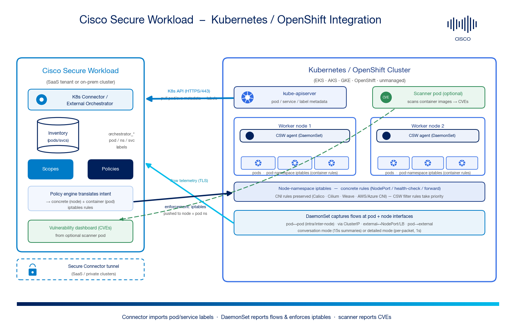

# Cisco Secure Workload → Kubernetes / OpenShift Integration Guide


[](https://github.com/chandrapati/csw-kubernetes-integration/stargazers)
[](https://github.com/chandrapati/csw-kubernetes-integration/network/members)
[](https://github.com/chandrapati/csw-kubernetes-integration/commits/main)

A step-by-step, **beginner-friendly** guide to integrating a **Kubernetes or OpenShift cluster** with **Cisco Secure Workload (CSW)** — the **connector** (pod/service label import), the **node-agent DaemonSet** (flow visibility + enforcement), **iptables-based micro-segmentation** for pods & services, and optional **container image CVE scanning**.

[](https://www.cisco.com/go/secureworkload)
[](https://kubernetes.io/docs/home/)
[](https://docs.openshift.com/)
[-007BC7)](https://www.cisco.com/c/m/en_us/products/security/secure-workload-compatibility-matrix.html)

> **⚠ Disclaimer:** This is a **community reference guide** prepared by Cisco Solutions Engineering — not an official Cisco product document. Always refer to the [official Cisco Secure Workload documentation](https://www.cisco.com/c/en/us/support/security/tetration/series.html), the [Secure Workload and Kubernetes deep-dive](https://secure.cisco.com/secure-workload/docs/secure-workload-and-k8s), and the [Compatibility Matrix](https://www.cisco.com/c/m/en_us/products/security/secure-workload-compatibility-matrix.html) for authoritative, up-to-date guidance.

---

## What This Covers

| Area | Detail |
|---|---|
| **Integration type** | Kubernetes **connector / external orchestrator** (`type: kubernetes`) **+ node-agent DaemonSet** |
| **Data imported** | Pods, services, namespaces, nodes + pod labels/annotations → `orchestrator_*` labels |
| **Transport** | K8s API over HTTPS (TCP/443) for inventory; TLS agent channel for flows & policy |
| **Visibility** | ✅ Full east-west flow visibility (pod↔pod, via ClusterIP, external↔NodePort/LB, pod→external) |
| **Enforcement** | ✅ **iptables** — concrete rules in the **node** namespace, container rules in the **pod** namespace |
| **Vulnerability scanning** | ✅ Optional scanner pod → container image **CVEs** → CVE-risk-based policy |
| **Platforms** | EKS · AKS · GKE · OpenShift (SDN) · unmanaged Kubernetes · Linux & Windows nodes |
| **CNIs** | Calico · Cilium · Weave · Azure CNI · AWS VPC CNI (CNI-agnostic; CNI rules preserved) |
| **Connectivity** | Direct (on-prem) or via **Secure Connector** tunnel (SaaS / private clusters) |

---

## Quick Start

### Prerequisites
- A supported cluster (EKS / AKS / GKE / OpenShift **SDN** / unmanaged) with the **K8s API** reachable over HTTPS/443
- **Cluster admin** to install the DaemonSet; a **read-only** service account for the connector ([`examples/connector-rbac.yaml`](examples/connector-rbac.yaml))
- CSW **4.x** with Site Admin / Root Scope Owner rights
- (SaaS / private cluster) a healthy **Secure Connector** tunnel
- Firewall: HTTPS (TCP/443) CSW → K8s API; TLS node → CSW

### Steps (summary)
1. **Connector** — `Manage → Connectors → Kubernetes` (or `External Orchestrators → Type = Kubernetes`); provide kubeconfig/token → get **pod/service labels** into CSW.
2. **DaemonSet** — download the **CSW-generated** installer (`Manage → Agents → Installer → Kubernetes`) and `kubectl apply` it → one agent **per node** for **flows + enforcement**.
3. **Preserve rules** — enable it in the Agent Config (mandatory so CSW coexists with the CNI).
4. **Discover & analyze** — build policy from flows; validate with live analysis (no enforcement).
5. **Enforce** — flip the workspace to enforced; CSW programs **node + pod iptables**. Roll out per namespace.
6. **Scan (optional)** — enable vulnerability scanning for container-image CVEs.

### Verify
```bash
kubectl -n tetration get daemonset          # DESIRED == READY == node count
kubectl -n tetration get pods -o wide        # one CSW agent per node, Running
```
In CSW: `Investigate → Inventory Search` → `orchestrator_system/orch_type = kubernetes`.

See the [full step-by-step guide](CSW-Kubernetes-Integration-Guide.md) or [open the HTML version](CSW-Kubernetes-Integration-Guide.html).

---

## Architecture Diagram



*The connector pulls pod/service metadata over the K8s API into CSW inventory as labels. The DaemonSet node agents report flow telemetry and enforce policy by programming node- and pod-namespace iptables. An optional scanner pod reports container CVEs. For SaaS/private clusters the paths ride a Secure Connector tunnel.*

---

## Enforcement model in one table

CSW translates label **intent** into two iptables tiers (full detail + examples in [`examples/enforcement-iptables-reference.md`](examples/enforcement-iptables-reference.md)):

| Flow | Node-namespace (concrete) | Pod-namespace (container) |
|---|---|---|
| Pod → pod (direct) | — (CNI forward) | egress on src pod, ingress on dst pod |
| Pod → pod via ClusterIP | — | egress to service IP; ingress on dst pod (DNAT auto) |
| Node → pod (health check) | egress node→pod:port | ingress from node IPs |
| External → pod (NodePort/LB) | ingress any→NodePort | ingress any→pod:port |
| Pod → external | — (SNAT + forward) | egress to external IP |

---

## Files in This Repo

| File | Description |
|---|---|
| [`README.md`](README.md) | This file — quick start and overview |
| [`CSW-Kubernetes-Integration-Guide.md`](CSW-Kubernetes-Integration-Guide.md) | Full step-by-step guide (Markdown source) |
| [`CSW-Kubernetes-Integration-Guide.html`](CSW-Kubernetes-Integration-Guide.html) | Styled HTML — open in a browser |
| [`csw-kubernetes-architecture.png`](csw-kubernetes-architecture.png) | Architecture diagram |
| [`make_architecture.py`](make_architecture.py) | Regenerate the architecture diagram (requires matplotlib) |
| [`build.sh`](build.sh) | Regenerate HTML/PDF from Markdown (requires pandoc + Chrome) |
| [`examples/connector-rbac.yaml`](examples/connector-rbac.yaml) | Read-only RBAC for the connector service account |
| [`examples/csw-agent-daemonset.yaml`](examples/csw-agent-daemonset.yaml) | **Representative** node-agent DaemonSet (learning only — deploy the CSW-generated bundle) |
| [`examples/enforcement-iptables-reference.md`](examples/enforcement-iptables-reference.md) | How intent → node/pod iptables, with verification commands |
| [`docs/CUSTOMER-HANDOFF.md`](docs/CUSTOMER-HANDOFF.md) | Checklist to hand to the customer's platform / Kubernetes team |
| [`docs/00-official-references.md`](docs/00-official-references.md) | Authoritative Cisco + Kubernetes doc links |

---

## Video References

> There is no single "CSW + Kubernetes DaemonSet" walkthrough video; the ones below cover the **connector**, **labels**, **scopes**, and **enforcement** concepts this guide builds on. See the guide's [§13](CSW-Kubernetes-Integration-Guide.md#13-video-references).

| Video | Why it's relevant |
|---|---|
| [Connector Overview](https://youtu.be/H6QxuouzeC8) | Connector / orchestrator context-enrichment pattern |
| [Cisco Secure Workload: Labels](https://www.youtube.com/watch?v=NLoZq0wiTU8) | How pod/service labels drive policy |
| [Cisco Secure Workload: Scopes](https://www.youtube.com/watch?v=3KBmanCNm4U) | Turn namespace/service labels into a scope tree |
| [Production and Test Risk Reduction](https://www.youtube.com/watch?v=HKT18Ylt4IY) | Monitor → enforce rollout discipline |
| [CSW-User-Education library](https://github.com/chandrapati/CSW-User-Education) | Full curated CSW learning path |

---

## Step-by-Step Guides

Hands-on integration and deployment guides — follow these top to bottom to build out a deployment:

| Guide | Description | Best for |
|-------|-------------|---------|
| [Agent Installation](https://github.com/chandrapati/CSW-Agent-Installation-Guide) | Deploy CSW agents on Linux / Windows / cloud | Day-1 sensor deployment |
| [Kubernetes / OpenShift](https://github.com/chandrapati/csw-kubernetes-integration) | K8s connector + DaemonSet: pod/service labels, flow visibility, iptables enforcement, CVE scanning | Container segmentation |
| [Policy Lifecycle](https://github.com/chandrapati/CSW-Policy-Lifecycle) | Policy discovery → enforcement workflow | Policy management |
| [vCenter](https://github.com/chandrapati/csw-vcenter-integration) | VMware vCenter VM identity + tag/category label import | Virtualization-driven policy |
| [ISE / pxGrid](https://github.com/chandrapati/csw-ise-integration) | ISE/pxGrid: user-identity–aware microsegmentation | Identity & Zero Trust |
| [ServiceNow CMDB](https://github.com/chandrapati/csw-servicenow-integration) | ServiceNow CMDB label enrichment for workload scopes | CMDB-driven policy |
| [Infoblox](https://github.com/chandrapati/csw-infoblox-integration) | Infoblox IPAM/DNS extensible-attribute label enrichment | IPAM/DNS-driven policy |
| [F5 BIG-IP](https://github.com/chandrapati/csw-f5-integration) | F5 virtual-server labels, policy enforcement, IPFIX flow visibility | Load balancer segmentation |
| [NetScaler ADC](https://github.com/chandrapati/csw-netscaler-integration) | NetScaler LB virtual-server labels + ACL policy enforcement | Load balancer segmentation |
| [Edge Connector](https://github.com/chandrapati/csw-edge-connector) | Edge appliance: ISE/AD/ServiceNow labels + Syslog/Email/Slack/PagerDuty/Kinesis alerts | Enrichment & alerting |
| [Ingest Connector](https://github.com/chandrapati/csw-ingest-connector) | Ingest appliance: NetFlow v9 / IPFIX / NSEL / ERSPAN flow ingest | Agentless flow visibility |
| [Secure Connector](https://github.com/chandrapati/csw-secure-connector) | SaaS reverse-tunnel proxy to private orchestrator APIs (no inbound holes) | SaaS → on-prem reachability |
| [AWS Connector](https://github.com/chandrapati/csw-aws-connector) | EC2 tag ingestion + VPC flow logs + Security Group enforcement | AWS workloads |
| [Azure Connector](https://github.com/chandrapati/csw-azure-connector) | Azure VM tag ingestion + VNet flow logs + NSG enforcement | Azure workloads |
| [GCP Connector](https://github.com/chandrapati/csw-gcp-connector) | GCE label ingestion + VPC flow logs + firewall enforcement | GCP workloads |
| [NetFlow](https://github.com/chandrapati/csw-netflow-integration) | NetFlow v9/IPFIX agentless flow ingestion from switches | Network fabric visibility |
| [ERSPAN](https://github.com/chandrapati/csw-erspan-integration) | Agentless packet mirroring for legacy / OT / IoT devices | Deep agentless visibility |
| [Secure Firewall](https://github.com/chandrapati/CSW-Secure-Firewall-Integration-Guide) | NSEL flow ingestion from Cisco Secure Firewall (FTD/ASA) | Firewall flow visibility |
| [K8s Demo Apps on vSphere](https://github.com/chandrapati/csw-lab-k8s-demo-apps-vsphere) | Terraform kubeadm cluster on vCenter running Sock Shop + Online Boutique — ready-made east-west target for this connector | Lab / POV K8s workloads |
| [Siwapp Lab App (vSphere)](https://github.com/chandrapati/siwapp-app-vsphere) | Terraform multi-tier demo app (PostgreSQL + HAProxy + Elixir) on any vCenter lab — a realistic east-west segmentation target | Lab / POV demo workloads |
| [Splunk Integration](https://github.com/chandrapati/csw-splunk-integration) | CSW syslog alerts → Splunk SIEM | SecOps / SIEM teams |

## Resources

Learning paths, reference material, and day-2 tooling:

| Resource | Description | Best for |
|----------|-------------|---------|
| [User Education](https://github.com/chandrapati/CSW-User-Education) | Onboarding guides, concept explainers, and curated video library | New CSW users |
| [Compliance Mapping](https://github.com/chandrapati/CSW-Compliance-Mapping) | Map CSW controls to NIST, PCI-DSS, HIPAA, CIS | Compliance & audit |
| [Tenant Insights](https://github.com/chandrapati/CSW-Tenant-Insights) | Tenant-level reporting and analytics | Visibility metrics |
| [Operations Toolkit](https://github.com/chandrapati/CSW-Operations-Toolkit) | Day-2 ops scripts: health checks, reporting, policy analysis | Ongoing operations |
| [Tetragon (eBPF) for Segmentation](https://github.com/chandrapati/tetragon-ebpf-segmentation) | What Tetragon is in the eBPF world and its role in segmentation — and how it fits next to Cilium & Secure Workload | eBPF / runtime enforcement |

> **Suggested customer journey:**
> User Education → Agent Installation → Kubernetes / OpenShift → Policy Lifecycle → ISE/pxGrid → ServiceNow CMDB → Compliance Mapping → Operations Toolkit
